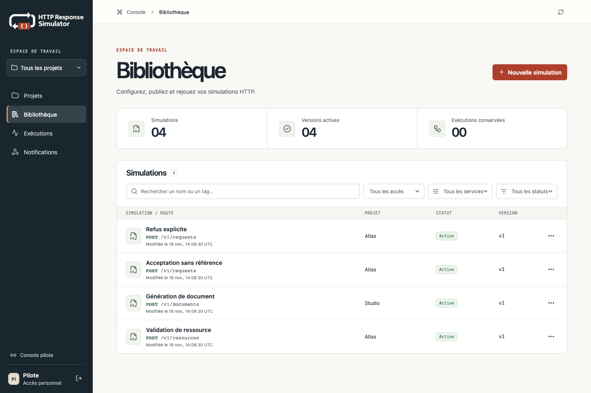

# HTTP Response Simulator — banc de test API

HTTP Response Simulator remplace une dépendance HTTP en recette. Chaque appel conforme sélectionne une version publiée, résout ses variables et conserve une trace. Un webhook facultatif peut partir après la réponse, y compris lorsque celle-ci est une erreur HTTP.



## Démarrer sur son poste

Avec Node.js 24, depuis la racine du dépôt, lancer les commandes suivantes.

```sh
cd frontend
npm ci
npm run dev
```

Ouvrir [la console locale](http://127.0.0.1:3210), puis choisir **Créer un compte**. L’inscription utilise une adresse e-mail et un mot de passe. Dans **Projets**, créer un projet puis y ajouter directement ses simulations. La clé affichée à la création du projet sert aux appels HTTP des clients de test.

Le compte Pilote existant conserve Atlas, Studio et les quatre scénarios de démonstration. Choisir **J’ai une ancienne clé** à la connexion pour associer ce compte à une adresse e-mail et à un mot de passe. Sa clé initiale figure dans le fichier privé `data/acces-pilote.json`. La migration préserve ses projets, ses versions et ses historiques.

Pour exécuter la version compilée, utiliser `npm run build` puis `npm start` dans `frontend/`. Les deux modes lancent la console, le worker et le récepteur HTTP local. La console écoute sur le port 3210 et le récepteur sur 3922. La variable `PORT` change le port de la console.

### Avec Docker

```sh
docker compose up --build -d
docker compose cp relais:/var/lib/relais/acces-pilote.json ./data-acces-pilote.json
```

Le volume nommé `relais_data` conserve les données entre deux démarrages. Le fichier copié contient des clés personnelles. Conserver ses droits en lecture privée. Pour utiliser simultanément Docker et le pilote natif, lancer Docker avec `RELAIS_PORT=3212 docker compose up --build -d`. Le récepteur reste interne au conteneur.

## Partager sur la même instance

Sur plusieurs postes, les utilisateurs doivent ouvrir la même adresse de l’instance HTTP Response Simulator. Pour héberger une instance d’équipe, placer la console derrière un proxy HTTPS, définir `RELAIS_ORIGIN` sur l’origine HTTPS exacte et conserver le volume de données. Les liens copiés depuis cette adresse ouvrent les ressources sur cette instance.

Dans **Projets**, choisir **Partager** sur un projet. Dans l’éditeur, choisir **Partager la simulation** pour une seule simulation. Saisir l’adresse d’un utilisateur déjà inscrit, ou choisir **Public pour tous les utilisateurs connectés**. Le bouton **Copier le lien** permet de transmettre le lien interne. Le destinataire voit aussi les éléments dans sa bibliothèque, avec le filtre **Partagées avec moi**.

Le partage donne la lecture et la duplication dans un projet personnel. Pour une simulation publiée, le destinataire voit la version active. Une simulation en brouillon partage sa configuration courante. Les historiques, les clés et les opérations de publication restent réservés aux membres du projet. Le partage d’un projet s’applique aussi à ses futures simulations. Chaque source de droit se retire indépendamment. Les copies déjà faites appartiennent à leurs destinataires.

Dans **Webhook différé**, activer la notification, saisir son **URL de réception** puis choisir **Enregistrer l’URL**. Le récepteur local fourni peut être utilisé immédiatement s’il est activé. Pour une nouvelle URL externe, le compte Pilote vérifie le service de recette puis l’autorise dans **Notifications**. La destination est alors disponible dans le projet concerné.

**Type de contenu** propose JSON, XML et texte. Un corps XML est validé avant publication et ses variables sont échappées dans le texte et les attributs. Dans un objet JSON, deux insertions successives ajoutent deux propriétés. Une sélection explicite permet de remplacer une valeur existante. Le bouton **Indenter le JSON** corrige également l’ancien cas de variables juxtaposées sans nom de propriété.

## Premier appel

1. Avec le compte Pilote, dans **Bibliothèque**, ouvrir **Validation de ressource**. La version 1 simule un POST qui renvoie HTTP 400.
2. Cliquer sur **Exécuter la version v1**. La chronologie indique le code servi, la version et la corrélation. La section des données contient le corps JSON et les variables masquées si nécessaire.
3. Pour brancher un client externe, copier le cURL depuis l’éditeur. Fournir la clé du projet via la variable locale `RELAIS_TEST_KEY` utilisée dans la commande. Le client peut joindre le SHA du code testé dans `X-Tested-Sha`. Chaque appel crée une nouvelle exécution.
4. Ouvrir **Génération de document** pour tester la réponse HTTP 202 et la notification à deux minutes. Suivre sa livraison dans **Exécutions**. Après une livraison réussie, **Rejouer la notification** permet de tester une fois le même message et la même clé d’idempotence.
5. Pour modifier un contrat, enregistrer le brouillon, vérifier l’aperçu puis publier. L’URL stable utilise la dernière version publiée. L’archivage désactive cette URL et conserve les preuves pendant la durée de rétention.

Un brouillon accepte du JSON incomplet. La publication exige une configuration valide. Une variable seule, par exemple `"{{quantite}}"`, restitue le type JSON de sa valeur. L’expression `"lot-{{quantite}}"` restitue une chaîne. Le mode **Champ entrant facultatif** lit un champ de premier niveau du corps JSON. Une donnée présente de type incorrect déclenche une erreur technique identifiable.

## Exploitation et tests

Les commandes suivantes s’exécutent dans `frontend/`.

| Commande | Vérification |
|---|---|
| `npm run test:lab` | Moteur, transactions, accès, masquage, versionnement, file, reprises et idempotence |
| `npm run lint && npm run typecheck && npm run build` | Analyse statique et compilation Next.js |
| `npm run test:browser` | Parcours bureau et mobile sur une base éphémère, après compilation |
| `npm run test:acceptance` | Quatre contrats fictifs sur le pilote démarré, livraison réelle à deux minutes puis doublon contrôlé |

Le test navigateur utilise Chrome sur macOS lorsqu’il est installé. Sur un autre poste, installer Chromium avec `npx playwright install chromium`. Après migration du compte Pilote, fournir ses identifiants au test de recette via `RELAIS_QA_EMAIL` et `RELAIS_QA_PASSWORD`. Le test de recette conserve les exécutions créées dans l’historique. Utiliser les scénarios initiaux avec leurs contrats d’origine.

- [Architecture, droits, destinations et limites du pilote](docs/exploitation.md)
- [Résultats de recette](docs/recette.md)
- [Cahier des charges du simulateur](https://docs.google.com/document/d/1n3dh1Gk7feDwRer23Dr9DjZy1AuGfQzXIbfdK0HdHHA/edit)

Le produit actif se trouve dans `frontend/src/lab`, ses routes dans `frontend/src/app` et les processus locaux dans `frontend/scripts/lab-*.mjs`. Le socle FastAPI initial, ses outils de supervision et les anciennes pages génériques sont conservés pour référence. Le premier commit Git contient le template tel qu’il a été reçu.
